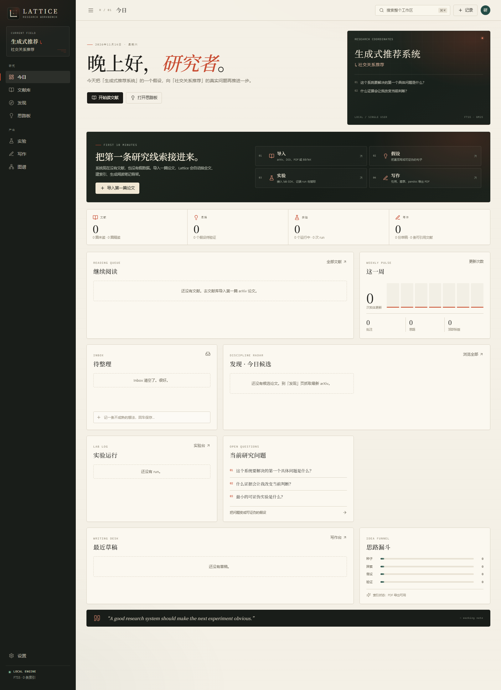
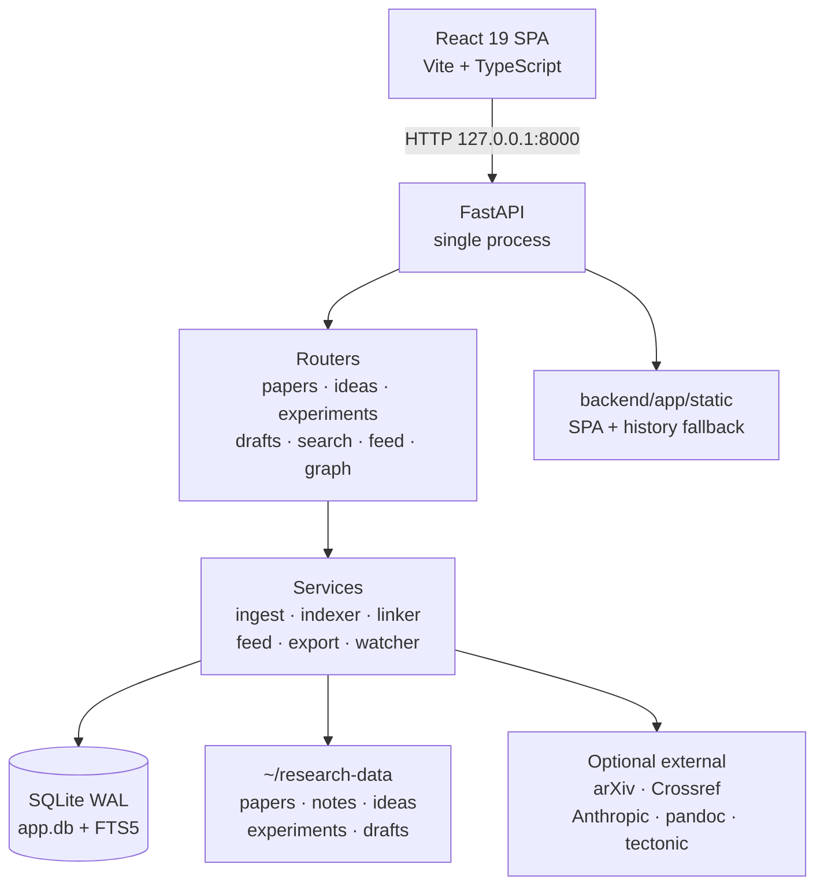

<p align="center">
  
</p>

<h1 align="center">Lattice</h1>

<p align="center">
  <strong>A local-first research workbench for reading, thinking, experimenting and writing.</strong><br />
  单进程 · SQLite FTS5 · Markdown 源文件 · 无账号 · 无云依赖
</p>

<p align="center">
  <a href="https://github.com/moolinks/lattice/actions/workflows/ci.yml"></a>
  <a href="LICENSE"></a>
  
  
  
  
</p>

---

> **这个仓库不附带论文、笔记、实验或研究结论。** 打开后是一个干净的空工作区；你导入的第一篇论文才会成为系统的第一份数据。

Lattice 把「读论文 → 写笔记 → 形成假设 → 跑实验 → 写草稿 → 导出 PDF」做进一个本地研究工作台。它不试图做另一个云笔记，也不把检索藏进向量数据库：长文本是 Markdown，结构化数据和全文索引在 SQLite，搜索引擎是 FTS5/BM25，整个系统只有一个 Python 进程。



## 目录

- [为什么做 Lattice](#为什么做-lattice)
- [功能](#功能)
- [快速开始](#快速开始)
- [架构](#架构)
- [数据与目录](#数据与目录)
- [搜索](#搜索)
- [Summary agent](#summary-agent)
- [实验 SDK](#实验-sdk)
- [写作与导出](#写作与导出)
- [API](#api)
- [测试](#测试)
- [配置](#配置)
- [备份与恢复](#备份与恢复)
- [安全模型](#安全模型)
- [路线图](#路线图)
- [License](#license)

## 为什么做 Lattice

研究工具很容易走向两个极端：

1. **大而全的平台**：账号、协作、云同步、向量库、任务队列。真正的个人研究被拆成十几个服务，维护成本高于研究本身。
2. **纯文件夹**：Markdown 很自由，但文献状态、全文检索、实验指标、引用关系和导出流程全靠手工。

Lattice 取中间道路：

- **一个人的系统**：无登录、无权限、无多租户，只监听 `127.0.0.1`。
- **一个进程**：FastAPI 同时提供 API 和构建后的 SPA，没有 Nginx、Docker、Redis、Celery。
- **一个 SQLite 文件**：结构化元数据、关系、实验记录和 FTS5 索引都在 `app.db`。
- **Markdown 是长文本的唯一源**：Obsidian / VS Code 可以直接编辑，系统用 watchfiles 增量同步。
- **检索足够就好**：BM25 + trigram + 短查询 LIKE 回退，不引入 embedding。
- **AI 是可选增强**：没有 API Key 时，摘要与问答返回可追溯的原文证据，而不是假装模型已经回答。

## 功能

| 模块 | 能力 |
| --- | --- |
| 今日 | 阅读队列、Inbox、周活动、运行中实验、研究问题、arXiv 候选 |
| 文献库 | 状态 / 标签 / 年份筛选，排序，全文搜索，导入抽屉 |
| 导入 | arXiv ID/URL、DOI、本地 PDF、BibTeX；后台任务与进度轮询 |
| PDF | PyMuPDF 抽取元数据、逐页文本、约 1300 字符分块；浏览器内阅读 |
| 笔记 | CodeMirror 6 Markdown 编辑器，保存后同步 FTS 与 `link` |
| 搜索 | FTS5 BM25，标题 ×10 / 正文 ×1；中文 trigram；1–2 字 LIKE 回退 |
| 命令面板 | `Cmd/Ctrl + K`，跨论文、笔记、思路、实验、草稿搜索 |
| 发现 | 按关键词抓取 arXiv，相关性打分；收藏即导入，支持忽略 |
| 思路板 | 五列看板、拖拽状态、Markdown 工作区、转为实验 |
| 实验 | Experiment / Run / Metric / Artifact；曲线叠加与超参差异 |
| 写作 | 大纲 / CodeMirror / KaTeX 实时预览；`[@bibkey]` 引用；`{{run:...}}` 图表 |
| 导出 | pandoc → LaTeX → tectonic，中文字体自适应；HTML 导出兜底 |
| 图谱 | front matter、`[[ID]]`、引用、run 占位符生成可追溯关系图 |
| Summary agent | 结构化摘要 + 页码证据 + `summary_record` 审计记录；可选 Anthropic |
| 快速记录 | `Cmd/Ctrl + Shift + I` 写入 Inbox，不打断当前工作 |
| 文件监听 | watchfiles 增量同步外部编辑的 `.md` |
| 定时任务 | APScheduler 每日抓取 arXiv |
| 备份 | SQLite 在线快照 + Markdown zip；设置页一键创建 |

**明确不做**：登录鉴权、多用户、公网部署、向量数据库、语义 embedding、Redis/Celery、微服务拆分、SaaS 云同步。

## 快速开始

### 前置条件

- Python **3.11+**
- Node **20+**，pnpm **10+**
- 可选：pandoc + tectonic（PDF 导出）
- 可选：`ANTHROPIC_API_KEY`（LLM 摘要 / 问答）

### 一条命令（Windows）

```powershell
git clone https://github.com/moolinks/lattice.git
cd lattice
start.cmd
```

`start.cmd` → `scripts/start.ps1` 会自动：

1. `uv sync` 安装后端依赖；
2. 如果 `backend/app/static/index.html` 不存在，则 `pnpm install && pnpm build`；
3. 在 `http://127.0.0.1:8000` 启动 FastAPI。

### 手动启动

```bash
# 后端
cd backend
uv sync
uv run uvicorn app.main:app --host 127.0.0.1 --port 8000

# 前端开发模式（可选，另一个终端）
cd ../frontend
pnpm install
pnpm dev          # http://127.0.0.1:5173，代理 /api → 8000
```

### 第一次使用

应用默认是空的：

1. 打开 **文献库** → **导入文献**，粘贴 arXiv ID，例如 `1706.03762`；
2. 等待后台下载 PDF、抽取全文、建立索引；
3. 在 **论文详情** 里写笔记、添加批注；
4. 在 **思路板** 新建假设，或从论文笔记中的 `[[I0001]]` 建立关系；
5. 在 **实验** 里创建实验，用 [lab SDK](#实验-sdk) 上报 run；
6. 在 **写作** 里引用论文、插入 run 图表，导出 HTML / PDF。

### 安装外部工具

Windows：

```powershell
pwsh -File scripts/install-tools.ps1
```

macOS：

```bash
brew install pandoc tectonic
```

没有 pandoc / tectonic 时，应用仍可运行；PDF 导出会返回明确的 503 和安装提示，HTML 导出仍可用。

## 架构



| 层 | 选择 | 原因 |
| --- | --- | --- |
| API | FastAPI + Uvicorn | 单进程、类型友好、静态托管简单 |
| 数据 | SQLite + SQLModel | 零部署、事务、FTS5 原生 |
| 检索 | FTS5 BM25 + trigram | 中文无需 jieba，短查询 LIKE 回退 |
| 前端 | React + Vite + TS | 构建后由 FastAPI 托管 |
| 编辑器 | CodeMirror 6 | 原始 Markdown，中文 IME 稳定 |
| PDF | PyMuPDF | 文本、页码、元数据、缩略图 |
| 导出 | pandoc → LaTeX → tectonic | 数学、引用、中文、可复现 |
| AI | Anthropic（可选） | 无 Key 时自动回退到本地证据 agent |

## 数据与目录

默认数据目录：`~/research-data`（可用 `RESEARCH_DATA_DIR` 覆盖）。

```text
~/research-data/
├── papers/P0001.pdf
├── notes/P0001.md
├── ideas/I0001.md
├── experiments/E0001/
│   ├── notes.md
│   └── runs/E0001-R01/...
├── drafts/D0001/
│   ├── main.md
│   ├── refs.bib
│   └── figures/
├── attachments/
├── backups/
├── logs/
├── app.db
└── config.json
```

**硬约定**：数据目录不放进代码仓库；应用不写死仓库路径。切换机器只需要带走 `~/research-data` 和代码。

### 数据表

| 表 | 用途 |
| --- | --- |
| `paper` | 元数据、状态、评分、bibkey、PDF 与笔记路径 |
| `chunk` | 按页切分的全文块，`P0001-C0001` |
| `annotation` | 页码、原文、评论、可选 `rects` |
| `idea` | 思路状态、优先级、Markdown 路径 |
| `experiment` / `run` / `metric` / `artifact` | 实验、运行、指标、产物 |
| `draft` | 草稿、venue、状态、主 Markdown |
| `summary_record` | 每次摘要的模式、模型、证据链、prompt 版本 |
| `link` | `inspired_by` / `cites` / `uses` / `related` / `tests` |
| `tag` / `entity_tag` | 标签 |
| `inbox` / `feed_item` | 快速记录 / arXiv 候选 |
| `counter` | 可读 ID：P/I/E/D/R |
| `import_job` | 导入进度 |

ID 约定：

```text
论文 P0001 · 分块 P0001-C0001 · 思路 I0001
实验 E0001 · 运行 E0001-R01 · 草稿 D0001
```

## 搜索

```sql
SELECT row_id, entity_id, type, page, title,
       snippet(search_fts, 5, '<mark>', '</mark>', '…', 28) AS snippet,
       bm25(search_fts, 0, 0, 0, 0, 10.0, 1.0) AS score
FROM search_fts
WHERE search_fts MATCH :q
ORDER BY score ASC
LIMIT :limit;
```

- `bm25()` 越小越相关；后端升序返回，前端不二次排序。
- 标题权重 10 / 正文权重 1，可在设置页调整后一键重建索引。
- 用户输入统一经过 `to_fts_query()` 转义，禁止把原始输入拼进 MATCH。
- trigram 至少需要 3 个字符；`len(q) < 3` 自动走 `LIKE`。
- 结果按 `entity_id` 去重；`paper_chunk` 命中归并到论文并保留最佳页码。
- 索引写入集中在 `services/indexer.py`，不使用 FTS 触发器；API 写入、watcher、全量 reindex 共用同一条路径。

## Summary agent

论文摘要不是“一个没有出处的字符串”，而是一条可审计记录。

```text
PDF chunks
   ↓ BM25 / section-aware evidence selection
Evidence[]  (role, page, chunk_id, quote)
   ↓
┌─────────────────────────────┐
│ 有 ANTHROPIC_API_KEY ?      │
│  是 → LLM 结构化摘要        │
│  否 → 本地提取式证据 agent  │
└─────────────────────────────┘
   ↓
summary_record (mode, model, evidence JSON, prompt_version)
   ↓
paper.ai_summary + UI 证据链
```

实现位置：[`backend/app/agents/paper_summarizer.py`](backend/app/agents/paper_summarizer.py)。

- **无 Key 模式**：从摘要和分块中选问题、方法、证据、局限段落，附 `(p.X)` / `(abstract)` 引用，并明确标记 `local-extractive`，不冒充 LLM 综合。
- **有 Key 模式**：把证据交给 Anthropic，要求“只根据证据、每个关键论断带页码、证据不足要直说”。
- **失败回退**：LLM 调用失败会保留证据并退化为本地摘要，记录模式为 `local-fallback`。
- **历史**：`GET /papers/{id}/summaries` 返回每次摘要及证据，UI 可重新生成。

> 这正是“summary 可以先记录好”的含义：先保存证据和 agent 运行记录，再决定是否让模型综合。没有证据链的摘要，Lattice 不会把它当成可信结论。

## 实验 SDK

`sdk/lab` 是零第三方依赖的 Python 实验记录 SDK。

```python
from lab import Run

with Run(experiment="E0001", params={"lr": 1e-3, "seed": 42}) as run:
    for step, (loss, acc) in enumerate(train()):
        run.log(step, loss=loss, recall_at_20=acc)

    run.save_artifact("curve.png", kind="figure")
    run.summary(final_recall=acc)
```

安装：

```bash
cd sdk
pip install -e .
```

行为：

- 自动记录 git commit、工作区脏状态、命令行、随机种子、主机名；
- 指标批量上报（默认 20 个点或 1.2 秒）；
- 服务未启动时写入 `experiments/E0001/runs/<local>.jsonl`；
- 下次 `Run` 启动自动补传并标记 `.synced.jsonl`；
- 产物复制到数据目录对应 run 下再登记。

## 写作与导出

草稿源文件：`~/research-data/drafts/D0001/main.md`

```markdown
生成式推荐正在从排序转向生成 [@vaswani2017attention]。

{{run:E0001-R01/curve.png}}
```

- 保存时扫描 `[@bibkey]` 与 `{{run:...}}`，同步 `cites` / `uses`；
- 导出前从 `paper.bibtex` 聚合 `refs.bib`；
- HTML：pandoc `--citeproc --mathml --standalone`；pandoc 缺失时回退 markdown-it；
- PDF：pandoc → LaTeX → tectonic，自动选择 `Microsoft YaHei` / `PingFang SC` / `Noto Sans CJK SC`；
- 渲染失败写 `drafts/<id>/.exports/export.log`，API 返回可操作的错误信息。

## API

完整 OpenAPI：<http://127.0.0.1:8000/api/docs>

| 模块 | 接口 |
| --- | --- |
| 健康 / 首页 | `GET /api/health`、`GET /api/dashboard` |
| 文献 | `GET/PATCH /api/papers`、`GET /api/papers/{id}`、`GET /api/papers/{id}/pdf` |
| 导入 | `POST /api/papers/import`、`POST /api/papers/upload`、`GET /api/papers/imports/{job}` |
| 笔记 / 批注 | `PUT /api/papers/{id}/note`、`POST/DELETE /api/papers/{id}/annotations` |
| 摘要 | `POST /api/papers/{id}/summarize`、`GET /api/papers/{id}/summaries` |
| 问答 | `POST /api/papers/{id}/ask` |
| 思路 | `GET/POST /api/ideas`、`GET/PATCH/DELETE /api/ideas/{id}`、`POST /api/ideas/{id}/promote` |
| 实验 | `GET/POST /api/experiments`、`GET/PATCH /api/experiments/{id}` |
| 对比 | `GET /api/experiments/{id}/compare?runs=E0001-R01,E0001-R02` |
| 运行 | `POST /api/runs`、`POST /api/runs/{id}/metrics`、`/finish`、`/artifacts` |
| 草稿 | `GET/POST /api/drafts`、`GET/PUT /api/drafts/{id}`、`GET/POST /api/drafts/{id}/export` |
| 搜索 | `GET /api/search?q=&type=&limit=` |
| 关系 / 图谱 | `GET/POST /api/links`、`GET /api/graph` |
| 发现 | `GET /api/feed`、`POST /api/feed/refresh`、`POST /api/feed/{id}/accept` |
| 收集箱 | `GET/POST/PATCH/DELETE /api/inbox` |
| 运维 | `POST /api/admin/reindex`、`POST /api/admin/backup`、`GET /api/admin/stats` |
| 设置 | `GET/PATCH /api/settings` |

## 测试

### 单元 / API 测试

```bash
cd backend
uv run pytest -q
uv run ruff check app tests
```

覆盖：健康检查、文献、FTS5 搜索、短查询回退、笔记、批注、思路、关系、实验 run/metric/compare、草稿 HTML 导出、设置、reindex。

### 全功能 live E2E

> 使用独立数据目录，不会触碰你的真实研究数据。

```powershell
$env:RESEARCH_DATA_DIR = "$PWD\..\e2e-data"
$env:RESEARCH_HUB_SCHEDULER = "0"
cd backend
uv run uvicorn app.main:app --host 127.0.0.1 --port 8765

# 另一个终端
uv run python ../scripts/e2e_live.py --base-url http://127.0.0.1:8765
```

覆盖 54 项检查：

- arXiv 导入、真实 PDF 下载（内容类型 + `%PDF` + 字节数）
- FTS5 搜索、短查询回退、页码命中
- summary agent、证据链、摘要历史、落库
- 问答 fallback、批注、笔记、思路、转实验
- run / metric / artifact / finish / compare
- 草稿 HTML / PDF 导出、引用、实验图
- inbox、feed refresh/accept/ignore、PDF 上传、重复检测
- 设置、reindex、stats、backup

结果记录：[`docs/E2E_REPORT.md`](docs/E2E_REPORT.md)。

### 前端

```bash
cd frontend
pnpm build
```

浏览器冒烟测试覆盖：首页、文献库、导入弹窗、论文详情、PDF tab、思路抽屉、实验图表、写作预览、图谱、设置、命令面板与移动端布局。所有页面均无 console error，桌面 / 390px 移动端无横向溢出。

## 配置

`~/research-data/config.json`：

| 键 | 说明 |
| --- | --- |
| `research_field` / `research_focus` | 今日页、摘要提示、arXiv 抓取上下文 |
| `research_questions` | 研究问题列表 |
| `arxiv_keywords` / `arxiv_categories` | arXiv 抓取条件 |
| `bm25_title_weight` / `bm25_body_weight` | 搜索权重 |
| `anthropic_model` | 摘要 / 问答模型 |
| `anthropic_api_key` | 可选；也可用环境变量 `ANTHROPIC_API_KEY` |
| `daily_feed_enabled` / `daily_feed_hour` | 定时抓取 |

环境变量：

```text
RESEARCH_DATA_DIR=~/research-data
RESEARCH_HUB_URL=http://127.0.0.1:8000
ANTHROPIC_API_KEY=sk-ant-...
RESEARCH_HUB_SCHEDULER=0   # 关闭定时任务
RESEARCH_HUB_WATCHER=0     # 关闭文件监听
```

## 备份与恢复

```powershell
# SQLite 一致快照 + Markdown zip
pwsh -File scripts/backup.ps1

# 重建 FTS + 关系（幂等）
pwsh -File scripts/reindex.ps1
```

原则：

- Markdown、`refs.bib`、figures 进 git；
- `app.db` 用 `sqlite3 .backup` / Python `backup()` 做一致快照；
- PDF 原文件进 restic / 外置盘；
- FTS 索引和 `link` 表不备份，`reindex.py` 可重建；
- 至少做一次 **恢复 → `PRAGMA integrity_check` → 启动应用** 的完整演练。

## 安全模型

- 默认只监听 `127.0.0.1`，**没有登录鉴权**；不要暴露公网。
- 单用户、单进程；没有权限模型。
- API Key 只写在本地 `config.json` 或环境变量，不会提交。
- 可选 AI 请求会把论文片段发送给 Anthropic；不需要 AI 时不要配置 Key。
- 备份包含完整研究数据，按敏感数据管理。

## 路线图

- PDF 框选高亮（`react-pdf-highlighter-extended`，`annotation.rects` 已预留）
- Alembic baseline 与 schema 版本检查
- 真实训练脚本的 run 模板与更多图表类型
- GROBID 可选 sidecar（不影响主进程）
- 更强的本地摘要：章节识别、图表/表格抽取、引用消歧
- 可选的多设备同步，但不改变本地优先模型

## License

[MIT](LICENSE) © 2026 Funing Yang

---

<p align="center">
  <sub>Built with FastAPI · SQLModel · SQLite FTS5 · React · CodeMirror 6 · ECharts · PyMuPDF · pandoc · tectonic</sub>
</p>
